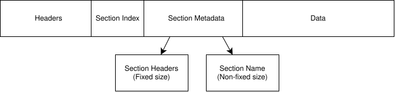

# Introduction of Proka Executable

## Overview
Proka Executable (*PKE*) is an executable developed by *RainSTR Studio*. It keeps *Simple, Multiple usage* and is fit for the current ProkaOS architecture.

In order to parse PKE easily, we have made a Rust crate on [crates.io](https://crates.io/crates/proka-exec), and [Docs.rs](https://docs.rs/proka-exec) for definitions.

The source repository is at *https://github.com/RainSTR-Studio/proka-exec.git*

## Each element of PKE
These are the elements which PKE had:

- `Header`: The identify of PKE, which also contains important data;
- `SectionIndex`: Describes where the `SectionHeader` is and the section name size;
- `SectionHeader`: Essential information container of a section;
- *Section Name*: The name of section;

We will explain it further in *Chapter 4*.

## Basic Structure of PKE
Compared with ELF, PKE's designing is much more simple. Here is the basic structure of PKE, which shows the sequence of each elements:

From this figure, you could find that:

- The `Header` is in the head of the whole file. You need to get some essential informations from this part for further parsing;
- The `SectionIndex` is following the `Header`. You can read this to fine **where the `SectionMetadata` is** and **the length of the *Section Name* **;
- The `SectionMetadata` combines `SectionHeader` and *Section Name*. For flexibility, the *Section Name*'s size is **NOT** fixed, and the length could be find at `SectionIndex`.
