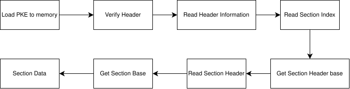

# Ways to Parse/Construct PKE

## Parse PKE
Since you have known each elements and structure of PKE, we coild do further step - parse it.

The first thing, which is also the most important thing is: to load PKE buffer into memory, or you couldn't parse it correctly.

::: {.callout-important}
1. In this chapter, we might use some mathematics style. This constant in mathematics mode is defined as follow:

    - *b*: The base address of the whole PKE buffer ($b \in \mathbb{N}$);
    - $v_{\mathit{xxx}}$: The variable named `xxx`;

2. If no special announcement, all of the variable in mathematics are belongs to $\mathbb{N}$.
:::

### Check `Header`
Once you loaded the PKE buffer, please do:

1. Check magic number. PKE'S magic is `PKEX`. If not, it's 100% incorrect;
2. Check `version_xxx`. Ensure your parser version is between `version_minimal` and `version_maximum` (of course, using the `version_current` is the best);
3. *(For kernel)* Check is the current kernel version between `min` and `max`;
4. Check is section count zeroed (expected: no);

After this validation, the PKE is **seemed** legal. To het information of this PKE, feel free to see @sec-pke-header.

### Get Sections
To get sections of PKE, you should construct `SectionIndex` first.

Now you need to iterate each `SectionIndex`, the iteration counts can be find in `sections` field in `Header`.

Let *i*=the index count, $a_{\mathit{si}}$=the address of destinition `SectionIndex`, then we have:

$$
a_{\mathit{si}} = b + \mathtt{0x80} + (\mathtt{0x40}i), \quad i \in [0, v_{\mathit{header}.\mathit{sections}})
$$

Since we have construct the `SectionIndex`, you could get `SectionHeader` to get further informations.

Let $a_{\mathit{sh}}$=`SectionHeader` address, *A*=all section name character set. To construct `SectionHeader` or get this section name, you can do these:

\begin{gather*}
a_{\mathit{sh}} = b + v_{\mathit{secindex}.\mathit{base}} \\
A = [a_{\mathit{sh}} + \mathtt{0x10},\; a_{\mathit{sh}} + \mathtt{0x10} + v_{\mathit{secindex}.\mathit{name\_len}}]
\end{gather*}

Let *B*= the data sets, you could get the data's base address and its length through:

\begin{gather*}
a_{\mathit{data}} = b + v_{\mathit{sechead}.\mathit{base}} \\
B = [a_{\mathit{data}}, a_{\mathit{data}} + v_{\mathit{sechead}.\mathit{size}})
\end{gather*}

For further informations, you shall lookup the `SectionHeader`'s definitions. See also @sec-pke-section-hdr.

The loading precedure can be described by following figure:

